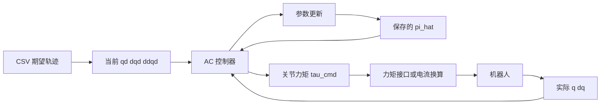

# 从当前七参数 Y_a 构建普通 AC 控制器：详细实施指南

日期：2026-10-12。

本指南对应你刚生成的 **2×7 控制回归矩阵**，以及 `E:\Y2_1\20261012_AC\MATLAB` 中的当前代码。它使用当前模型的正弦重力项、黏性摩擦项和 `Lambda=3I`，不沿用早期水平零位、四参数示例的列顺序。

## 1. 有了这个矩阵，是否就能构建控制器？

**可以。你已经完成控制器的动力学回归部分，接下来补上参数估计、误差反馈和数据接口，就能组成普通力矩型 AC。**

已有：

$$
Y_a(q,\dot q,q_d,\dot q_d,\ddot q_d)\pi
=M(q)a_r+C(q,\dot q)v_r+G(q)+F_v\dot q.
$$

完整控制器需要：

$$
\boxed{\tau_{\mathrm{cmd}}=Y_a\hat\pi-K_s s},
\qquad
\boxed{\dot{\hat\pi}=-\Gamma Y_a^Ts}.
$$

这里 `Y_a` 是已知系数矩阵，`pi_hat` 是当前动力学参数估计，`-Ks*s` 是误差反馈。仅生成或计算 `Y_a` 的数值，不会自动完成控制，也不会自动更新参数。

本文选用经典 Slotine–Li 型直接自适应控制。原始方案采用动力学补偿、误差反馈与在线参数估计，可参考 [Slotine 与 Li 的原始论文](https://journals.sagepub.com/doi/10.1177/027836498700600303)。下面的参数顺序、公式与代码按你的实际工程整理。

## 2. 先核对七个参数，避免矩阵和估计向量错位

你给出的矩阵第一行开头是 `dq_1`，第二行最后是 `dq_2`，因此摩擦参数位于第 1、7 列。

本次重新运行当前代码，得到的 `pi_param` 为：

$$
\boxed{
\pi=
\begin{bmatrix}
f_{v1}\\
A\\
B\\
H_1\\
D\\
H_2\\
f_{v2}
\end{bmatrix}}
$$

| 列号 | 参数 | 当前物理定义 | 在模型中的作用 |
|---|---|---|---|
| 1 | $f_{v1}$ | 第一关节黏性摩擦系数 | 第一关节的实际速度项 |
| 2 | $A$ | $I_{zz1}+m_1l_{c1}^2+m_2L_1^2$ | 第一关节惯性贡献 |
| 3 | $B$ | $m_2L_1l_{c2}$ | 惯性与速度耦合 |
| 4 | $H_1$ | $m_1l_{c1}+m_2L_1$ | 第一关节重力组合 |
| 5 | $D$ | $I_{zz2}+m_2l_{c2}^2$ | 第二连杆惯性贡献 |
| 6 | $H_2$ | $m_2l_{c2}$ | 第二连杆重力组合 |
| 7 | $f_{v2}$ | 第二关节黏性摩擦系数 | 第二关节的实际速度项 |

`Izz` 是质心惯量，平行轴项已经包含在上面的组合里，不能再重复加入。

**必须使用七维 `pi_hat`，且顺序和表格一致。** 更改参数化、已知量配置、采样或主元选择后，以那次运行的 `pi_param` 为准。

早期四参数模型采用另一组基；把那个四维向量放进当前 2×7 矩阵会产生尺寸错误，调整成七维但排列不对应则会产生错误力矩。

## 3. 把你贴出的矩阵整理成容易理解的形式

定义实际反馈 `q、dq` 和期望轨迹 `qd、dqd、ddqd`，均为 2×1 列向量：

$$
e=q-q_d,\quad \dot e=\dot q-\dot q_d,
\quad \Lambda=\begin{bmatrix}3&0\\0&3\end{bmatrix}.
$$

$$
v_r=\dot q_d-\Lambda e,
\quad a_r=\ddot q_d-\Lambda\dot e,
\quad s=\dot q-v_r=\dot e+\Lambda e.
$$

你的展开式中的：

```text
ddqd_1 - 3*dq_1 + 3*dqd_1       就是 ar1
dqd_1 - 3*q_1 + 3*qd_1         就是 vr1
```

定义：

$$
\begin{aligned}
Z_1={}&2\cos q_2\,a_{r1}+\cos q_2\,a_{r2}
-\dot q_2\sin q_2\,v_{r1}
-(\dot q_1+\dot q_2)\sin q_2\,v_{r2},\\
Z_2={}&\cos q_2\,a_{r1}+\dot q_1\sin q_2\,v_{r1}.
\end{aligned}
$$

那么当前矩阵就是：

$$
\boxed{
Y_a=
\begin{bmatrix}
\dot q_1&a_{r1}&Z_1&g\sin q_1&a_{r1}+a_{r2}&g\sin(q_1+q_2)&0\\
0&0&Z_2&0&a_{r1}+a_{r2}&g\sin(q_1+q_2)&\dot q_2
\end{bmatrix}}.
$$

因此你不是在控制中使用一个不可理解的长公式，而是在每一帧计算七组动力学系数。

其中摩擦列保留实际 `dq`；它们不是 `vr`。完整力矩可展开为：

$$
\begin{aligned}
\tau_{1}={}&\hat f_{v1}\dot q_1+\hat A a_{r1}+\hat B Z_1
+g\hat H_1\sin q_1+\hat D(a_{r1}+a_{r2})
+g\hat H_2\sin(q_1+q_2)-(K_s s)_1,\\
\tau_{2}={}&\hat B Z_2+\hat D(a_{r1}+a_{r2})
+g\hat H_2\sin(q_1+q_2)+\hat f_{v2}\dot q_2-(K_s s)_2.
\end{aligned}
$$

这些正弦项与当前 `RNEA_SYM.m` 的第一关节 `-pi/2` 偏移一致。`data_verify.m` 中仍有早期“水平零位”的注释；坐标约定以当前 MDH、重力方向和实际生成表达式为准。

## 4. 运行中哪些量来自哪里

| 量 | 来源 | 维度 | 是否每周期变化 |
|---|---|---|---|
| `qd、dqd、ddqd` | CSV 对应控制时刻的期望轨迹 | 各 2×1 | 是 |
| `q、dq` | 机器人反馈，或仿真对象状态 | 各 2×1 | 是 |
| `e、de、vr、ar、s` | 控制器计算 | 各 2×1 | 是 |
| `Ynum` | 已导出的回归函数 | 2×7 | 是 |
| `pi_hat` | 上一周期保留的参数估计 | 7×1 | 是，启用更新时 |
| `Lambda` | 控制配置 | 2×2 | 第一版固定 |
| `Ks` | 控制配置 | 2×2 | 第一版固定 |
| `Gamma` | 控制配置 | 7×7 | 第一版固定 |
| `tau_cmd` | 模型补偿加误差反馈 | 2×1 | 是 |

不需要采集真实 `ddq`。期望加速度 `ddqd` 也不是实际加速度。

开始前初始化一次 `pi_hat`；每周期结束保存更新结果；下一周期继续使用。不能每帧把它重置回初值。

## 5. 三个矩阵怎么设置，以及 Lambda 固化的问题

### 5.1 Lambda：位置误差与速度误差的组合

当前矩阵中已经写入系数 `3`，所以其对应的 `Lambda` 为 `3I`。

若直接使用展开后的 `Y_a`，计算 `s` 时也必须使用同一个 `Lambda`。不能一边保留当前展开矩阵，一边把 `s` 的增益改为其他数值。

有两种实现方式：

| 方式 | 数值函数输入 | 改 Lambda 时 |
|---|---|---|
| A：导出当前 `Y_a` | `q,dq,qd,dqd,ddqd` | 修改生成脚本并重新生成、导出矩阵，保持 `s` 配置一致 |
| B：导出 `Y_a_reference` | `q,dq,vr,ar` | 在控制器内重新计算 `vr、ar、s`，无需为 Lambda 重导出参考矩阵 |

下面代码采用方式 A，直接对应你贴出的矩阵，并加入配置一致性检查。

### 5.2 Ks：跟踪误差反馈增益

第一版可以使用对角正定矩阵，例如：

```matlab
Ks = diag([8,4]);
```

这个值只是启动仿真的配置。较大的增益一般会产生更强的误差反馈，同时改变力矩和动态响应，需要结合实际结果调节。

### 5.3 Gamma：参数估计更新增益

当前七个参数量纲、作用强度不同，采用对角矩阵分别设置，例如：

```matlab
Gamma = diag([0.01,0.3,0.02,0.02,0.2,0.01,0.01]);
```

这组数值只用于本指南演示，不是已经在真实机器人上调好的增益。最初可以关闭自适应，先验证固定参数控制；再开启更新并观察误差、估计值和力矩。

如果参数基或单位改变，不能直接照搬这组学习增益。

## 6. 离线准备：把符号矩阵变为可调用的数值函数

建议将本节代码保存为 `MATLAB/prepare_ac_controller.m`。后续其他函数也保存到同一目录。

此函数会重新执行一次完整建模，避免重复添加摩擦；生成数值回归函数和初始估计，并提供单独的标称对象供仿真使用。

**下列物理参数是演示用标称值，摩擦系数 0.1、0.2 尤其不是你设备的测量结果。真实应用应替换为自己的标称参数。**

```matlab
function [ctrl,model] = prepare_ac_controller()
addpath(fileparts(mfilename('fullpath')));
RNEA_SYM;
data_verify;
add_friction;
generate_Y_pi;
generate_Y_a;

assert(N==2 && numel(pi_param)==7, ...
       '本指南示例需要当前二连杆七参数配置。');

% 只在 Ya 中代入已知量，不把待估计物理参数代入回归矩阵
Y_known = simplify(subs(Y_a,g,sym('9.81')));
ctrl.Ya = matlabFunction(Y_known, ...
    'Vars',{mat_q,mat_dq,mat_qd,mat_dqd,mat_ddqd});

% 将标称物理参数映射到同一次生成的 pi_param
phys_symbols = [mat_m;mat_lc_value;mat_Izz_value; ...
                mat_L;mat_Fv_value;g];
phys_nominal = sym({'23.902';'3.88'; ...
                    '0.091';'0.048'; ...
                    '1.266';'0.093'; ...
                    '0.45';'0.45'; ...
                    '0.1';'0.2';'9.81'});
ctrl.pi0 = double(subs(pi_param,phys_symbols,phys_nominal));

ctrl.N = N;
ctrl.p = numel(pi_param);
ctrl.Lambda = Lambda;
ctrl.LambdaGenerated = Lambda; % 保存已展开矩阵的增益，供一致性检查
ctrl.Ks = diag([8,4]);
ctrl.Gamma = diag([0.01,0.3,0.02,0.02,0.2,0.01,0.01]);
ctrl.adapt = false;            % 第一阶段先关闭参数更新

% 以下 model 用于对象仿真，不参与实际控制器的力矩计算
M_nom = simplify(subs(M_a,phys_symbols,phys_nominal));
C_nom = simplify(subs(C_a,phys_symbols,phys_nominal));
G_nom = simplify(subs(G_a,phys_symbols,phys_nominal));
F_nom = simplify(subs(F_a,phys_symbols,phys_nominal));
model.M = matlabFunction(M_nom,'Vars',{mat_q});
model.C = matlabFunction(C_nom,'Vars',{mat_q,mat_dq});
model.G = matlabFunction(G_nom,'Vars',{mat_q});
model.F = matlabFunction(F_nom,'Vars',{mat_q,mat_dq});
model.pi_true = ctrl.pi0;       % 仅用于这个演示对象的评估
end
```

按本次参数顺序，演示初始估计为：

$$
\hat\pi_0=
[0.1,\ 2.249632462,\ 0.083808,\ 3.921082,\ 0.10193952,\ 0.18624,\ 0.2]^T.
$$

标称初始化不等于已知真实参数。实际参数与标称值存在偏差时，在线估计用于调整补偿。

`matlabFunction` 的 `Vars` 应显式指定为向量输入，避免默认变量排序带来接口错误。用法见 [MathWorks 官方文档](https://www.mathworks.com/help/symbolic/sym.matlabfunction.html)。

离线生成完成后，实际循环内调用 `ctrl.Ya(...)` 即可，不反复执行符号运算或 SVD/QR。

## 7. 控制器核心函数：先计算力矩和参数导数

保存为 `MATLAB/ac_compute.m`：

```matlab
function [tau_cmd,dpi_hat,obs] = ac_compute(q,dq,qd,dqd,ddqd,pi_hat,ctrl)
q=q(:); dq=dq(:); qd=qd(:); dqd=dqd(:); ddqd=ddqd(:);
pi_hat=pi_hat(:);
assert(all([numel(q),numel(dq),numel(qd),numel(dqd),numel(ddqd)]==ctrl.N));
assert(numel(pi_hat)==ctrl.p);
assert(all(isfinite([q;dq;qd;dqd;ddqd;pi_hat])));
assert(isequal(ctrl.Lambda,ctrl.LambdaGenerated), ...
       'Lambda 与已导出的 Y_a 不一致，请重新生成矩阵。');

e = q-qd;
de = dq-dqd;
vr = dqd-ctrl.Lambda*e;
ar = ddqd-ctrl.Lambda*de;
s = de+ctrl.Lambda*e;

Ynum = ctrl.Ya(q,dq,qd,dqd,ddqd);
assert(isequal(size(Ynum),[ctrl.N,ctrl.p]));
assert(all(isfinite(Ynum),'all'));
tau_model = Ynum*pi_hat;
tau_feedback = -ctrl.Ks*s;
tau_cmd = tau_model+tau_feedback;

dpi_hat = -ctrl.Gamma*Ynum.'*s;
if ~ctrl.adapt
    dpi_hat = zeros(ctrl.p,1);
end
obs = struct('e',e,'de',de,'vr',vr,'ar',ar,'s',s, ...
             'Ya',Ynum,'tau_model',tau_model,'tau_feedback',tau_feedback);
end
```

这个函数不读取 CSV，不采集机器人，不更新永久状态，也不发送力矩。它只把当前输入变成当前力矩和参数变化率。

`tau_model` 与 `tau_feedback` 分别记录，有助于观察力矩来自模型补偿还是误差反馈。

## 8. 离散控制周期：保存更新后的 pi_hat

真实采样控制可以使用以下包装函数，保存为 `MATLAB/ac_step.m`：

```matlab
function [tau_cmd,pi_next,obs] = ac_step(q,dq,qd,dqd,ddqd,pi_hat,Ts,ctrl)
assert(isscalar(Ts) && isfinite(Ts) && Ts>0);
[tau_cmd,dpi_hat,obs] = ac_compute(q,dq,qd,dqd,ddqd,pi_hat,ctrl);
pi_next = pi_hat(:)+Ts*dpi_hat;
assert(all(isfinite(pi_next)));
end
```

每周期的调用形式为：

```matlab
[tau_cmd,pi_next,obs] = ac_step( ...
    q_meas,dq_meas,qd,dqd,ddqd,pi_hat,Ts,ctrl);
% 这里通过你的设备接口发送 tau_cmd，或发送换算后的电流。
pi_hat = pi_next; % 下一周期继续使用，不能重新赋成 ctrl.pi0
```

离散参数更新是前向 Euler：

$$
\hat\pi_{k+1}=\hat\pi_k-T_s\Gamma Y_a(k)^Ts(k).
$$

`Ts` 应对应实际更新周期。连续时间理论不会自动保证任意采样周期下的离散实现稳定；采样、延迟及实际施加的力矩需要单独验证。

如果用 `ode45` 做连续时间仿真，应将 `pi_hat` 作为 ODE 状态，并使用 `ac_compute` 返回的 `dpi_hat`；不要在 ODE RHS 内调用 `ac_step` 手动累计参数。

## 9. 读取 CSV：期望量不是反馈量

当前目录没有提供实际轨迹 CSV。以下代码约定列名为：

```text
t,q1,q2,dq1,dq2,ddq1,ddq2
```

单位：秒、rad、rad/s、rad/s²。实际文件列名不同时，应修改读取映射。

保存为 `MATLAB/load_reference_csv.m`：

```matlab
function traj = load_reference_csv(csv_file)
T = readtable(csv_file);
required = {'t','q1','q2','dq1','dq2','ddq1','ddq2'};
assert(all(ismember(required,T.Properties.VariableNames)), ...
       'CSV 需要 t,q1,q2,dq1,dq2,ddq1,ddq2 列。');
assert(height(T)>=2);
raw_t = T.t;
traj.t = raw_t(:)-raw_t(1);
traj.q = T{:,{'q1','q2'}};
traj.dq = T{:,{'dq1','dq2'}};
traj.ddq = T{:,{'ddq1','ddq2'}};
assert(all(isfinite([traj.t,traj.q,traj.dq,traj.ddq]),'all'));
assert(all(diff(traj.t)>0),'时间必须严格递增。');
end
```

读取表格的接口见 [MathWorks：readtable](https://www.mathworks.com/help/matlab/ref/readtable.html)。

如果 CSV 没有时间列，需要明确其采样周期，才能建立时间轴。不能仅凭行号确定速度和加速度应在什么时候执行。

若轨迹网格与控制周期完全一致，可直接取对应行并转成列向量：

```matlab
qd = traj.q(k,:).';
dqd = traj.dq(k,:).';
ddqd = traj.ddq(k,:).';
```

位置、速度、加速度必须对应同一时间；实际 `q、dq` 也应尽量同步。关节顺序、正方向和编码器零位须转换到本模型的坐标约定。

### 9.1 不同时间网格时，使用一致的参考插值

连续时间仿真会在 CSV 行之间求值。不要分别随意插值三组列后，默认它们仍互为导数。

下面用每个区间的两端位置、速度、加速度构造五次多项式，一次得到一致的三组参考量。保存为 `MATLAB/sample_reference_csv.m`：

```matlab
function [qd,dqd,ddqd] = sample_reference_csv(t,traj)
assert(isscalar(t) && isfinite(t));
assert(t>=traj.t(1)-1e-9 && t<=traj.t(end)+1e-9, ...
       '请求时刻超出轨迹范围。');
t = min(max(t,traj.t(1)),traj.t(end));
k = find(traj.t<=t,1,'last');
k = min(k,numel(traj.t)-1);
h = traj.t(k+1)-traj.t(k);
x = (t-traj.t(k))/h;

c0 = traj.q(k,:);
c1 = h*traj.dq(k,:);
c2 = 0.5*h^2*traj.ddq(k,:);
rhs = [traj.q(k+1,:)-c0-c1-c2; ...
       h*traj.dq(k+1,:)-c1-2*c2; ...
       h^2*traj.ddq(k+1,:)-2*c2];
high = [1,1,1;3,4,5;6,12,20]\rhs;
coef = [c0;c1;c2;high];

qd = ([1,x,x^2,x^3,x^4,x^5]*coef).';
dqd = ([0,1,2*x,3*x^2,4*x^3,5*x^4]*coef/h).';
ddqd = ([0,0,2,6*x,12*x^2,20*x^3]*coef/h^2).';
end
```

该插值保持区间端点条件，但并不自动保证区间内部满足设备运动限制。应检查整条参考轨迹的峰值速度、加速度及起止段。

## 10. 第一个闭环实验：先在 MATLAB 对象上验证

控制器只接收估计量；仿真对象使用自己的参数计算真实运动。二者必须区分。

当前连续时间状态为：

$$
x=[q^T,\dot q^T,\hat\pi^T]^T\in\mathbb R^{11}.
$$

因为有两个位置、两个速度和七个参数估计，状态维数是 **11**。

保存为 `MATLAB/ac_rhs.m`：

```matlab
function dx = ac_rhs(t,x,model,ctrl,traj)
N = ctrl.N;
q = x(1:N);
dq = x(N+1:2*N);
pi_hat = x(2*N+1:end);
[qd,dqd,ddqd] = sample_reference_csv(t,traj);
[tau_cmd,dpi_hat] = ac_compute(q,dq,qd,dqd,ddqd,pi_hat,ctrl);

M = model.M(q);
C = model.C(q,dq);
G = model.G(q);
F = model.F(q,dq);
ddq = M\(tau_cmd-C*dq-G-F);
dx = [dq;ddq;dpi_hat];
end
```

`M\(...)` 是仿真对象的正向动力学计算。实际机器人上由设备执行力矩并反馈 `q、dq`，不需要控制器再通过这个公式计算反馈状态。

### 10.1 一个可复制的 CSV 仿真入口

保存为 `MATLAB/run_ac_csv_sim.m`：

```matlab
function result = run_ac_csv_sim(csv_file,enable_adaptation)
[ctrl,model] = prepare_ac_controller();
ctrl.adapt = logical(enable_adaptation);
traj = load_reference_csv(csv_file);

q0 = traj.q(1,:).';
dq0 = zeros(ctrl.N,1);
pi_hat0 = 0.8*ctrl.pi0; % 只在演示仿真中制造相同的初始估计偏差
x0 = [q0;dq0;pi_hat0];
tspan = traj.t;
opts = odeset('RelTol',1e-6,'AbsTol',1e-8, ...
              'MaxStep',min(0.01,min(diff(traj.t))));
[t,x] = ode45(@(t,x) ac_rhs(t,x,model,ctrl,traj),tspan,x0,opts);
assert(all(isfinite(x),'all'));

E = zeros(numel(t),ctrl.N);
S = zeros(numel(t),ctrl.N);
Tau = zeros(numel(t),ctrl.N);
Qd = zeros(numel(t),ctrl.N);
for k = 1:numel(t)
    [qd,dqd,ddqd] = sample_reference_csv(t(k),traj);
    [tau,~,obs] = ac_compute(x(k,1:ctrl.N).', ...
        x(k,ctrl.N+1:2*ctrl.N).',qd,dqd,ddqd, ...
        x(k,2*ctrl.N+1:end).',ctrl);
    E(k,:) = obs.e.';
    S(k,:) = obs.s.';
    Tau(k,:) = tau.';
    Qd(k,:) = qd.';
end
result = struct('t',t,'x',x,'qd',Qd,'e',E,'s',S, ...
                'tau',Tau,'pi_true',model.pi_true, ...
                'rmse',sqrt(trapz(t,E.^2)/(t(end)-t(1))));
end
```

分别调用，保持其他条件一致：

```matlab
fixed = run_ac_csv_sim('trajectory.csv',false);
adaptive = run_ac_csv_sim('trajectory.csv',true);
disp(fixed.rmse);
disp(adaptive.rmse);
```

这个入口默认采用连续时间参数更新，不代表已实现相同采样周期的真实离散控制。实际 CSV 需要满足本指南的列约定。

`0.8*ctrl.pi0` 只用于演示对象与估计之间的初始差异。真实控制使用实际标称估计，不通过未知真值制造偏差。

## 11. 一个与你矩阵一致的数值计算例子

本次已在 MATLAB 中核对以下单时刻输入：

$$
q=[0.2,0.1]^T,\quad \dot q=[0.05,0.08]^T,
$$

$$
q_d=[0.3,0.2]^T,\quad \dot q_d=[0.1,0.1]^T,
\quad \ddot q_d=[0,-0.02]^T.
$$

采用 `Lambda=3I`，可得：

$$
e=[-0.1,-0.1]^T,\quad \dot e=[-0.05,-0.02]^T,
$$

$$
v_r=[0.4,0.4]^T,\quad a_r=[0.15,0.04]^T,
\quad s=[-0.35,-0.32]^T.
$$

代入 `g=9.81`，你的矩阵数值约为：

$$
Y_a\approx
\begin{bmatrix}
0.05&0.15&0.3299&1.9489&0.19&2.8991&0\\
0&0&0.1512&0&0.19&2.8991&0.08
\end{bmatrix}.
$$

使用第 6 节的初始估计，`Ks=diag([8,4])`，得到：

$$
\tau_{\mathrm{feedback}}=[2.8,1.28]^T\ \mathrm{N\cdot m},
$$

$$
\boxed{\tau_{\mathrm{cmd}}\approx[11.3714,1.8680]^T\ \mathrm{N\cdot m}.}
$$

这说明完整计算链是：读取当前五组运动数据 → 计算误差 → 求矩阵数值 → 乘估计参数 → 加误差反馈。

若开启自适应，再计算 `dpi_hat=-Gamma*Ynum.'*s`。若 `Ts=0.001 s`，下一周期参数增量等于 `0.001*dpi_hat`，并不是直接把整个 `dpi_hat` 加到估计向量。

该例是单时刻计算核对，不代表上述参数已经在实际设备上取得稳定跟踪。

## 12. 力矩或电流接口应该接在哪里

你已确认支持关节力矩或电流指令。设备接口位于 `ac_step` 得到 `tau_cmd` 之后：



若接口接收关节力矩，按设备定义转换顺序、正方向和单位后发送。

若接口接收电机电流，在正方向统一的简化关系下，每轴：

$$
i_{\mathrm{cmd}}=\frac{\tau_{\mathrm{cmd}}}{\eta nK_t},
$$

其中 `n` 为减速比，`eta` 为效率，`Kt` 为力矩常数。实际接口可能已经在驱动内部完成一部分换算，应按设备定义和标定值配置，不能重复换算。

不要把 `tau_cmd` 当成位置增量或速度增量；它的单位是关节力矩。

实际执行中若发生力矩限幅或明显延迟，应记录计算力矩和实际执行反馈，单独评估其对闭环和参数更新的影响。本文没有为未知设备编造发送 API，也没有发送任何实际指令。

## 13. 一阶滤波器现在需要加吗？

**基础控制器不需要额外的一阶低通滤波器。** 你已有期望加速度和实际速度，而当前 `Y_a` 不依赖真实加速度。

必须保留的是：

$$
s=\dot e+\Lambda e.
$$

这叫滤波跟踪误差或误差组合，并非已经对反馈信号进行了低通滤波。

| 情况 | 处理 |
|---|---|
| MATLAB 仿真中直接获得 q、dq | 先不加测量滤波 |
| 实际反馈速度噪声较大 | 单独评估速度滤波、其延迟和闭环影响 |
| 想通过力矩预测误差增加参数辨识 | 属于后续复合自适应/辨识方案，需要另行构造回归滤波 |
| CSV 导数不一致或起止突变 | 修正轨迹生成或一致插值，不靠盲目过滤所有信号解决 |

若加入测量滤波，它放在反馈采集之后、误差及回归矩阵数值计算之前。滤波后的数据与理想真实状态存在差异，必须重新说明和验证实际闭环效果。

## 14. 为什么更新律可以与这个含摩擦的矩阵配套

真实对象为：

$$
M\ddot q+C\dot q+G+F_v\dot q=\tau.
$$

当前回归矩阵使用相同的实际摩擦项：

$$
Y_a\pi=M a_r+C v_r+G+F_v\dot q.
$$

相减后得到：

$$
M\dot s+Cs=Y_a\tilde\pi-K_s s,
\qquad \tilde\pi=\hat\pi-\pi.
$$

因此第 1、7 列使用实际速度，与这组闭环推导一致。

令：

$$
V=\frac12s^TM s+\frac12\tilde\pi^T\Gamma^{-1}\tilde\pi.
$$

在参数为常值、模型匹配、真实惯性矩阵正定、`Lambda/Ks/Gamma` 对称正定，以及相应轨迹与信号有界性条件下，利用 `Mdot-2C` 的斜对称性和参数更新律可得：

$$
\dot V=-s^TK_s s\leq0.
$$

进一步的跟踪收敛需要相应有界性条件；参数收敛还需要足够激励，不能仅从误差曲线小就断言每个估计都等于真值。

这套控制律无需求估计惯性矩阵的逆。不要为了“让每个参数看起来物理合理”随意逐元素截断估计，再仍声称与上述更新律完全相同；若要投影或泄漏修正，应作为另一项明确修改进行分析。

## 15. 具体实施顺序和验收内容

| 顺序 | 要完成的任务 | 通过标准 |
|---|---|---|
| 1 | 保存同次生成的 Y_a 与 pi_param，核对七列顺序 | 符号恒等式通过，参数排列正确 |
| 2 | 用 prepare_ac_controller 导出数值函数并初始化估计 | 给定输入返回有限的 2×7 矩阵 |
| 3 | 读取 CSV 并检查时间、单位、零位和导数一致性 | 能在任意轨迹内时刻生成三组参考量 |
| 4 | 用 ac_compute 和标称估计，关闭参数更新 | 力矩计算和误差方向正确 |
| 5 | 在对象仿真中运行固定参数与普通 AC 对照 | 状态、力矩、估计有限，观察跟踪趋势 |
| 6 | 检查连续实现与离散更新周期差异 | 有明确的采样、延迟和实际输出定义 |
| 7 | 用真实设备接口替换仿真对象 | 反馈和施加力矩映射正确，完成设备闭环验证 |

至少记录：`t、qd、q、dq、e、s、tau_cmd、pi_hat`；若可获得实际力矩或电流，也一并记录。

输出位置跟踪、误差、滤波误差、力矩以及七个估计量的曲线。计算全时段和末段 RMSE、峰值误差、峰值力矩；固定参数与 AC 使用相同参考、初始状态及反馈增益。

不预先保证 AC 的所有有限时段指标都优于固定参数控制。反馈很强时，两者都可能跟踪较好；应结合力矩与参数变化解释结果。

## 16. 当前已验证的内容与代码使用边界

本次已重新调用当前工程脚本，验证七参数顺序、控制回归恒等式、两种数值回归接口的一致性，以及第 11 节的单时刻力矩计算。

另外，将本文七个函数代码块原样提取到临时目录，在 MATLAB 中完成以下检查：控制力矩数值与第 11 节一致；关闭自适应时参数导数为零；开启离散更新后估计量正常变化；五次参考插值可准确还原已知三次、五次多项式及其导数；合成 CSV 的完整 3 秒连续时间仿真调用链通过，返回 11 维状态和有限力矩。

合成轨迹为 `qd1=0.30*sin(0.6*t)`、`qd2=0.25*sin(0.9*t+0.4)`，CSV 间隔为 `0.01 s`；采用本文标称对象、相同的 `0.8*pi0` 初始估计和相同反馈增益，得到：

| 3 秒演示实验 | 关节 1 RMSE，rad | 关节 2 RMSE，rad |
|---|---:|---:|
| 固定参数 | 0.0501628137 | 0.0089747540 |
| 开启普通 AC | 0.0491797118 | 0.0074008556 |

该测试确认代码块可以协同执行，并给出短时演示结果；它不是你的实际 CSV，不代表实机、长时间性能或参数辨识收敛已验证。

本指南中的函数代码已在临时目录验证，但不表示这些函数已经作为 `.m` 文件安装在工程中。真实 CSV 尚未提供；设备 API、采样周期、限幅及标定数据尚未接入。**单时刻计算与短时演示不能代替实际闭环稳定性和性能验证。**

后续如更改模型或参数基，应重新生成整个离线配置；更改 Lambda 时，按第 5 节处理展开式与误差计算的一致性。
