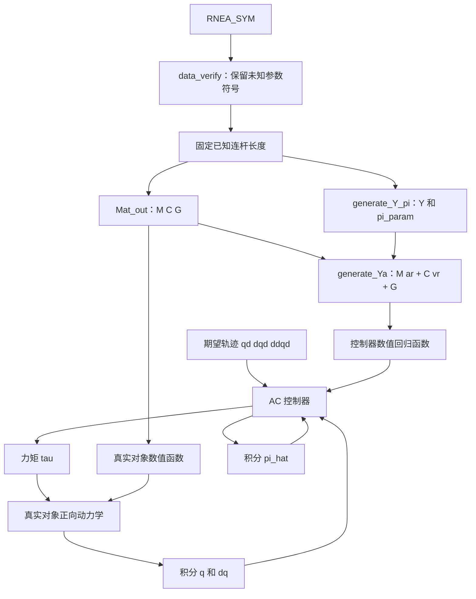

# 普通自适应控制 AC：当前代码的可行性分析与实施步骤

分析日期：2026-10-12。分析对象：本项目当前 MATLAB 源代码。

本文将“普通 AC”理解为：**基于刚体动力学线性参数化的关节空间直接自适应轨迹跟踪控制，即经典 Slotine–Li 型控制**。第一版采用理想、无摩擦的二连杆仿真，在线更新动力学参数组合，不引入复合学习、神经网络或扰动观测器。

## 1. 结论：可以做，现有代码适合作为动力学基础

**当前工程可以扩展成一个简单的普通自适应控制仿真。现有程序已经完成了建模和参数线性化，但尚未实现闭环控制。**

已经具备的关键关系是：

$$
\tau=M(q)\ddot q+C(q,\dot q)\dot q+G(q)
     =Y(q,\dot q,\ddot q)\pi.
$$

要完成 AC，主要还需要：

1. 设置真实仿真对象参数，并将动力学表达式转成数值函数。
2. 生成期望轨迹及其一阶、二阶导数。
3. 构造控制用回归矩阵 $Y_a(q,\dot q,\dot q_r,\ddot q_r)$。
4. 实现控制律和在线参数更新律。
5. 将 $q,\dot q,\hat\pi$ 一起积分，记录轨迹、误差、力矩和参数估计。
6. 与相同初始参数下的固定参数控制对比，并检查模型恒等式与闭环结果。

**建议第一版就使用当前的平面二连杆，假设连杆长度和重力加速度已知，质量、质心与惯量所形成的参数组合未知。** 不需要先辨识出每一个质量或质心，也不必在线运行 SVD/QR。

## 2. 当前各文件能提供什么

| 文件与位置 | 当前功能 | 对 AC 的作用 | 后续处理 |
|---|---|---|---|
| `RNEA_SYM.m` 第 7、19、59、173–189 行附近 | 定义二连杆 MDH、重力和空间 RNEA，生成符号 `tau` | 产生可信的逆动力学表达式 | 沿用，第一版保留 `N=2` |
| `make_T.m`、`make_X.m` | 构造齐次变换及空间运动变换 | 支撑 RNEA | 沿用 |
| `cross_3x1.m`、`cross_6x1.m`、`cross_star.m` | 实现空间向量叉乘及对偶叉乘 | 支撑 RNEA | 沿用 |
| `data_verify.m` 第 18–25、71 行附近 | 将模型简化为质心沿局部 x 轴、保留 `Izz` 的平面模型，并替换工作区 `tau` | 适合构造第一版二连杆控制对象 | 保持运动变量及未知惯性参数为符号 |
| `Mat_out.m` 第 27、30、33–50 行附近 | 提取 `M、G`，用 Christoffel 公式构造 `C` | 提供控制回归矩阵及正向动力学 | 沿用，并增加结构检查 |
| `generate_Y_pi.m` 第 23、152–206 行附近 | 随机采样、SVD/QR、提取 `pi_param` 和 `Y`，验证 `tau=Y*pi_param` | 提供固定参数基和回归矩阵 | 增加控制回归矩阵生成步骤 |
| `README.md` | 描述建模与参数集提取流程 | 说明当前工程目标 | 闭环实现后再补充运行入口 |

目前没有发现期望轨迹生成器、在线参数估计状态、控制力矩计算器或闭环 ODE 仿真入口。因此，运行现有脚本不会自动产生自适应跟踪控制结果。

### 2.1 当前模型的适用范围

- 两个旋转关节，旋转轴均为局部 z 轴。
- MDH 中第二关节相对第一关节的偏移使用 `L_1`。
- 重力为世界坐标系沿负 y 方向，`q_1=0` 是水平零位。
- 当前 `tau` 没有摩擦、外部接触力或执行器动力学。
- `data_verify.m` 默认只进行平面结构简化，保留 `m、lc、Izz、q、dq、ddq、g` 的符号。

特别注意：当前重力项是余弦形式。若参考论文采用竖直零位，其正弦形式不能直接照搬到本项目。

## 3. 本次实际核对结果，以及尚未验证的内容

本次使用本机 `F:\matlab2023\bin\matlab.exe`，在临时脚本中调用当前工程源文件，完成以下检查，未改动现有 `.m` 文件：

| 检查项 | 设置与结果 |
|---|---|
| 平面动力学 | 执行 `RNEA_SYM; data_verify; Mat_out;`，输出与第 5 节显式 `M、C、G` 完全一致 |
| 动力学结构 | 符号验证 $\dot M-2C$ 为斜对称矩阵，通过 |
| 已知长度的最小参数集 | 在 `tau` 中精确代入 `L_1=L_2=9/20`，再执行 `generate_Y_pi`；24 次采样，7 个参数单项式，4 个独立参数组合 |
| 原逆动力学回归 | 当前脚本自带的符号验证 `tau-Y*pi_param=0` 通过 |
| 控制回归矩阵 | 构造 `M*ar+C*vr+G`，沿用现有 `theta_full、parameter_map、base_columns`，符号验证 `tau_a-Ya*pi_param=0` 通过 |
| 显式四参数控制回归 | 第 5 节给出的 $Y_{a,4}$ 与同一模型符号一致，通过 |
| 数值力矩 | 使用第 8 节物理参数，`q=[0;pi/2]、dq=[1;2]、ddq=[1;-1]`，得到 `[40.044982882;0.083808] N·m` |

**验证范围：动力学和回归矩阵的正确性。本文后面的闭环控制示例是后续实现模板，本次没有执行完整 AC 轨迹跟踪仿真，也没有测得其误差收敛曲线。** 因此，下面的增益和验收阈值属于起始配置与建议，不能当作已验证的闭环性能。

## 4. 普通 AC 的控制律和更新律

经典机器人自适应控制使用动力学参数的线性结构，将模型补偿与误差反馈相结合。本文选用 Slotine–Li 方案，其文献出处可在 [MIT 非线性系统实验室论文目录](https://www.mit.edu/~nsl/) 中核对。下面的公式按本项目的误差定义重新推导。

### 4.1 统一误差符号

全文采用：

$$
e=q-q_d,\qquad \dot e=\dot q-\dot q_d.
$$

选择对称正定矩阵 $\Lambda$，定义参考速度、参考加速度和滤波误差：

$$
\dot q_r=\dot q_d-\Lambda e,
\qquad
\ddot q_r=\ddot q_d-\Lambda\dot e,
$$

$$
s=\dot q-\dot q_r=\dot e+\Lambda e.
$$

这里 $\ddot q_r$ 可由期望轨迹导数和实际速度直接算出，不需要测量实际 $\ddot q$。

### 4.2 控制用回归矩阵

需要构造：

$$
Y_a(q,\dot q,\dot q_r,\ddot q_r)\pi
=M(q)\ddot q_r+C(q,\dot q)\dot q_r+G(q).
$$

其中 `C` 的内部速度必须是实际 $\dot q$，乘在 `C` 右侧的速度才是 $\dot q_r$。

**不能将现有 `Y(q,dq,ddq)` 中的 `dq` 全部替换成 `dqr`，再将 `ddq` 替换成 `ddqr`。** 那样会得到 $C(q,\dot q_r)\dot q_r$，通常与上述控制律需要的项不同。

第一版最清楚的做法是先用 `Mat_out.m` 提取 `M、C、G`，再构造：

```matlab
tau_a = M*ar + C*vr + G;
```

`vr` 和 `ar` 是独立的符号参考速度、参考加速度，实际速度仍保留在 `C` 中。

### 4.3 控制力矩与在线参数更新

选择对称正定矩阵 $K_s$ 和 $\Gamma$：

$$
\boxed{\tau=Y_a\hat\pi-K_s s},
\qquad
\boxed{\dot{\hat\pi}=-\Gamma Y_a^T s}.
$$

两处负号与本文的 $e=q-q_d$ 一致。若换成相反的误差定义，应重新推导控制和更新符号。

参数维数为 $p=\operatorname{numel}(\pi)$：

| 量 | 维度 |
|---|---|
| `q、dq、qd、dqd、ddqd、vr、ar、e、s、tau` | `N×1` |
| `M、C、Lambda、Ks` | `N×N` |
| `G` | `N×1` |
| `Ya` | `N×p` |
| `pi_hat、dpi_hat` | `p×1` |
| `Gamma` | `p×p` |

### 4.4 为什么这组公式成立

真实动力学满足：

$$
M\dot s+Cs=Y_a\tilde\pi-K_s s,
\qquad \tilde\pi=\hat\pi-\pi.
$$

取 Lyapunov 函数：

$$
V=\frac12s^TM(q)s
 +\frac12\tilde\pi^T\Gamma^{-1}\tilde\pi.
$$

利用 $\dot M-2C$ 的斜对称性以及更新律，可得：

$$
\dot V=-s^TK_s s\leq0.
$$

在真实惯性矩阵正定、参数为常值、期望轨迹及所需导数有界、模型匹配并满足相应有界性条件时，可进一步建立 $s\to0$ 和 $e\to0$。

这不意味着所有参数估计必然收敛到真实值。**跟踪收敛与参数辨识收敛是两个不同目标。** 参数收敛还需要相应回归信号的持续激励等条件；离线随机采样矩阵满秩不能替代闭环轨迹的持续激励。

控制器只计算 `Ya*pi_hat`，无需求估计惯性矩阵的逆。在线估计的是固定动力学组合，也不要求每个组合都能单独解释为质量或惯量。

## 5. 当前二连杆的显式模型与四参数版本

这一节给出一个易于核对的显式实现。它与 `data_verify.m` 默认平面假设一致。

### 5.1 定义参数组合

设 `I1、I2` 是关于各自质心的 z 轴转动惯量，`lc1、lc2` 是局部 x 方向质心距离，`L=L_1` 为已知第一连杆长度：

$$
\begin{aligned}
a&=I_1+m_1l_{c1}^2+I_2+m_2l_{c2}^2+m_2L^2,\\
d&=I_2+m_2l_{c2}^2,\\
h_1&=m_1l_{c1}+m_2L,\\
h_2&=m_2l_{c2}.
\end{aligned}
$$

取：

$$
\theta_4=[a,d,h_1,h_2]^T.
$$

常见五参数写法还引入 $b=m_2Ll_{c2}$。但当 `L` 已知时，$b=Lh_2$，所以 `b` 与 `h2` 不应当作两个独立未知量。对于本文的平面模型和非零已知 `L、g`，本次自动提取也确认为四维。

若将长度作为未知量，或保留任意方向质心、摩擦等不同模型，则参数集会改变；四维结论不能直接推广到这些配置。第二连杆长度 `L_2` 没有作为独立几何量进入当前关节力矩模型，不能凭此模型单独辨识它。

### 5.2 惯性、科氏和重力项

令 $c_2=\cos q_2$、$s_2=\sin q_2$：

$$
M=
\begin{bmatrix}
a+2Lh_2c_2 & d+Lh_2c_2\\
d+Lh_2c_2 & d
\end{bmatrix},
$$

$$
C=Lh_2s_2
\begin{bmatrix}
-\dot q_2&-(\dot q_1+\dot q_2)\\
\dot q_1&0
\end{bmatrix},
$$

$$
G=g
\begin{bmatrix}
h_1\cos q_1+h_2\cos(q_1+q_2)\\
h_2\cos(q_1+q_2)
\end{bmatrix}.
$$

### 5.3 四参数控制回归矩阵

记 $v_r=\dot q_r$、$a_r=\ddot q_r$，定义：

$$
\begin{aligned}
z_1={}&L[2c_2a_{r1}+c_2a_{r2}
-s_2(\dot q_2v_{r1}+(\dot q_1+\dot q_2)v_{r2})]
+g\cos(q_1+q_2),\\
z_2={}&L[c_2a_{r1}+s_2\dot q_1v_{r1}]
+g\cos(q_1+q_2).
\end{aligned}
$$

则：

$$
\boxed{
Y_{a,4}=
\begin{bmatrix}
a_{r1}&a_{r2}&g\cos q_1&z_1\\
0&a_{r1}+a_{r2}&0&z_2
\end{bmatrix}}.
$$

本次已符号验证 $Y_{a,4}\theta_4=M a_r+C v_r+G$。

### 5.4 自动提取的参数顺序与手工顺序不同

本次在 `L=9/20` 的配置下，当前 `generate_Y_pi.m` 输出的是：

$$
\pi_{\mathrm{auto}}=
\begin{bmatrix}
I_1+m_1l_{c1}^2+m_2L^2\\
m_1l_{c1}+m_2L\\
m_2l_{c2}\\
I_2+m_2l_{c2}^2
\end{bmatrix}
=\begin{bmatrix}a-d\\h_1\\h_2\\d\end{bmatrix}.
$$

它与 $\theta_4$ 都是有效的四参数基，但对应回归矩阵的列不同。二者映射为：

$$
\theta_4=
\begin{bmatrix}
\pi_{\mathrm{auto},1}+\pi_{\mathrm{auto},4}\\
\pi_{\mathrm{auto},4}\\
\pi_{\mathrm{auto},2}\\
\pi_{\mathrm{auto},3}
\end{bmatrix}.
$$

**使用自动生成的 `Ya` 时，要配套使用自动生成的 `pi_param`；使用显式 `Ya4` 时，要配套使用 `[a;d;h1;h2]`。** 改采样种子、参数化或主元选择后，应以当次输出为准，不硬编码参数顺序。

## 6. 后续具体步骤：按这个顺序实现

### 步骤 1：固定第一版模型和已知量

采用 `N=2`，质心沿局部 x 轴，无摩擦、无外扰、理想关节力矩输入。

已知量：`L_1、L_2、g`。未知量：由 `m、lc、Izz` 构成的固定惯性参数组合。

在入口脚本中使用如下顺序即可，无需先改动 `generate_Y_pi.m` 的配置：

```matlab
RNEA_SYM;
data_verify;                  % 保持默认符号参数设置
tau_full = tau;               % 保存平面、长度未固定的版本
L_known = sym([9;9])/20;       % 示例长度 0.45 m，精确有理数
tau = simplify(subs(tau, mat_L, L_known));
Mat_out;
generate_Y_pi;
```

**不要取消 `data_verify.m` 中将质量、质心、惯量和状态全部数值化的整组示例注释后，再提取回归矩阵。** 那会丢失未知参数和运动符号。真实参数的数值代入应当发生在符号回归矩阵生成之后。

另一种方式是在 `generate_Y_pi.m` 中将 `known_symbols` 配置为 `[g;mat_L]`。该方式会在最终符号表达式中保留已知长度，数值导出时仍需代入它们。第一版直接在 `tau` 中固定长度，流程更容易核对。

交付物：同一符号模型上的 `tau、M、C、G、Y、pi_param`。

### 步骤 2：增加模型结构检查

至少检查：

```matlab
assert(isequal(simplify(M-M.'), sym(zeros(N))));
assert(isequal(simplify(expand(tau-M*mat_ddq-C*mat_dq-G)), ...
               sym(zeros(N,1))));

Mdot = sym(zeros(N));
for k = 1:N
    Mdot = Mdot + diff(M,mat_q(k))*mat_dq(k);
end
S = simplify(Mdot-2*C);
assert(isequal(simplify(S+S.'), sym(zeros(N))));
```

数值化后，对真实模型在代表性关节位置上检查 `M` 的最小特征值大于零。检查真实对象的惯性矩阵，不需要通过在线估计参数构造可逆的估计惯性矩阵。

交付物：动力学恒等式和结构检查通过。

### 步骤 3：生成控制回归矩阵 `Ya`

第一版建议沿用现有自动参数基，新增 `generate_Ya.m`。以下代码应接在步骤 1、2 之后运行：

```matlab
vr = sym('vr_', [N,1]);
ar = sym('ar_', [N,1]);
tau_a = simplify(M*ar + C*vr + G);

Ya_full = sym(zeros(N,parameter_count));
for i = 1:N
    [cc,tt] = coeffs(expand(tau_a(i)),parameter_symbols);
    for j = 1:numel(tt)
        [found,idx] = ismember(char(tt(j)),term_names);
        if ~found
            if isequal(cc(j),sym(0))
                continue;
            end
            error('generate_Ya:NewTerm', ...
                  '控制表达式出现新参数项，需要重新构造统一参数基。');
        end
        Ya_full(i,idx) = Ya_full(i,idx) + cc(j);
    end
end

Ya = simplify(Ya_full(:,base_columns));
assert(isequal(simplify(expand(Ya_full-Ya*parameter_map)), ...
               sym(zeros(size(Ya_full)))));
assert(isequal(simplify(expand(tau_a-Ya*pi_param)), ...
               sym(zeros(N,1))));
assert(isequal(simplify(expand( ...
    subs(Ya,[vr;ar],[mat_dq;mat_ddq])-Y)),sym(zeros(size(Y)))));
```

其中 `parameter_symbols、term_names、parameter_count、base_columns、parameter_map` 都来自当前 `generate_Y_pi.m`。必须来自同一次运行，不要混用不同模型的工作区变量。

该构造已在本文的平面、已知长度配置下验证通过。如果更换模型后检查失败，应针对统一的物理参数单项式以及 `q、dq、vr、ar` 的采样重新构建参数基，再验证恒等式；不能只靠增大控制增益掩盖参数化错误。

交付物：`Ya`，满足任意状态和独立参考速度、加速度下的符号恒等式。

### 步骤 4：建立数值模型，并区分对象真值与估计值

仿真对象知道真实参数，用于计算真实加速度；控制器只使用已知几何量、测得状态、参考轨迹和 `pi_hat`。

真实参数示例及数值导出代码：

```matlab
phys_symbols = [mat_m;mat_lc_value;I_zz(:);g];
phys_values = [sym('23.902');sym('3.88'); ...
               sym('0.091');sym('0.048'); ...
               sym('1.266');sym('0.093');sym('9.81')];

M_true_sym = simplify(subs(M,phys_symbols,phys_values));
C_true_sym = simplify(subs(C,phys_symbols,phys_values));
G_true_sym = simplify(subs(G,phys_symbols,phys_values));
pi_true = double(subs(pi_param,phys_symbols,phys_values));
Ya_known = simplify(subs(Ya,g,sym('9.81')));

plant.M = matlabFunction(M_true_sym,'Vars',{mat_q});
plant.C = matlabFunction(C_true_sym,'Vars',{mat_q,mat_dq});
plant.G = matlabFunction(G_true_sym,'Vars',{mat_q});
ctrl.Ya = matlabFunction(Ya_known,'Vars',{mat_q,mat_dq,vr,ar});
```

运行前确认 `Ya_known` 不再含未知物理参数；只允许出现 `q、dq、vr、ar`。`M_true_sym、C_true_sym、G_true_sym` 也应只含对应状态变量。

显式指定 `Vars` 可以固定向量输入接口，相关用法见 [MathWorks：matlabFunction](https://www.mathworks.com/help/symbolic/sym.matlabfunction.html)。导出后应实际调用一次各函数，核对返回尺寸与符号数值代入结果。

**符号计算集中在离线阶段完成。** 闭环积分中使用数值函数，不反复调用 `subs、simplify、coeffs、SVD、QR`。

交付物：`plant.M(q)、plant.C(q,dq)、plant.G(q)、ctrl.Ya(q,dq,vr,ar)` 与 `pi_true`。

### 步骤 5：生成光滑期望轨迹

第一版可使用不同频率的低速正弦轨迹，幅值用弧度，时间用秒：

```matlab
function [qd,dqd,ddqd] = reference_trajectory(t)
qd = [0.30*sin(0.6*t); 0.25*sin(0.9*t+0.4)];
dqd = [0.18*cos(0.6*t); 0.225*cos(0.9*t+0.4)];
ddqd = [-0.108*sin(0.6*t); -0.2025*sin(0.9*t+0.4)];
end
```

这些频率用于启动闭环测试，不构成持续激励已成立的证明。后续要研究参数收敛，可再使用多频轨迹并分析回归矩阵积分的最小特征值。

交付物：解析 `qd、dqd、ddqd`，避免用数值差分生成期望加速度。

### 步骤 6：实现控制器

新增 `ac_controller.m`：

```matlab
function [tau,dpi_hat,obs] = ac_controller(t,q,dq,pi_hat,ctrl)
[qd,dqd,ddqd] = reference_trajectory(t);
e = q-qd;
de = dq-dqd;
vr = dqd-ctrl.Lambda*e;
ar = ddqd-ctrl.Lambda*de;
s = dq-vr;
Ya = ctrl.Ya(q,dq,vr,ar);

tau = Ya*pi_hat-ctrl.Ks*s;
dpi_hat = -ctrl.Gamma*Ya.'*s;
obs = struct('qd',qd,'e',e,'s',s,'Ya',Ya);
end
```

此函数输入中不含真实质量、质心、惯量或 `pi_true`。`obs` 只用于记录和检查。

交付物：数值控制力矩和参数估计导数。

### 步骤 7：把运动状态和参数估计一起积分

定义完整状态：

$$
x=[q^T,\dot q^T,\hat\pi^T]^T.
$$

当前 `N=2、p=4`，因此状态维数是 8。新增 `ac_rhs.m`：

```matlab
function dx = ac_rhs(t,x,plant,ctrl)
N = ctrl.N;
q = x(1:N);
dq = x(N+1:2*N);
pi_hat = x(2*N+1:end);

[tau,dpi_hat] = ac_controller(t,q,dq,pi_hat,ctrl);
if isfield(ctrl,'adapt') && ~ctrl.adapt
    dpi_hat = zeros(size(pi_hat));  % 同一控制结构的固定参数基线
end

M = plant.M(q);
C = plant.C(q,dq);
G = plant.G(q);
ddq = M\(tau-C*dq-G);
dx = [dq;ddq;dpi_hat];
end
```

这里求解的是**真实仿真对象**的加速度，不是控制器在求估计惯性矩阵的逆。使用反斜杠求解，不写 `inv(M)`。

`pi_hat` 必须是 ODE 状态。不要在 RHS 中使用 `persistent` 或全局变量，通过 `pi_hat=pi_hat+dt*dpi_hat` 手动更新；自适应步长积分器可能在同一时间点多次求值，手动累加会产生错误。

交付物：对任意 `(t,x)` 返回同尺寸列向量的连续时间闭环 RHS。

### 步骤 8：增加仿真入口并设置初值

建议新增 `prepare_ac_model.m` 包含步骤 1–4，再新增 `run_ac_demo.m`：

```matlab
prepare_ac_model;             % 产生 plant、ctrl、pi_true、N、Ya
ctrl.N = N;
ctrl.Lambda = diag([3,3]);
ctrl.Ks = diag([8,4]);
ctrl.Gamma = diag([0.5,0.05,0.02,0.2]);
ctrl.adapt = true;

q0 = [0;0];
dq0 = [0;0];
pi_hat0 = 0.7*pi_true;        % 仅在仿真中制造统一的初始估计偏差
x0 = [q0;dq0;pi_hat0];
tgrid = (0:0.01:30).';
opts = odeset('RelTol',1e-6,'AbsTol',1e-8,'MaxStep',0.01);
[t,x] = ode45(@(t,x) ac_rhs(t,x,plant,ctrl),tgrid,x0,opts);
assert(all(isfinite(x),'all'));
```

这些增益是**上述自动四参数基**下的起始值，尚未进行闭环调参。换成显式四参数基、做参数归一化或改变单位后，应重新设置 `Gamma`。不同参数量纲不同，第一版也不要只靠把统一学习率设得很大来加速估计。

`0.7*pi_true` 只用于仿真对照实验的初始化；真实应用应改为由标称物理参数映射得到的初始估计，不能依赖未知真值。

`ode45` 接收一阶状态方程和初值；输入输出形式见 [MathWorks：ode45](https://www.mathworks.com/help/matlab/ref/ode45.html)。这里 `0.01 s` 是输出网格和最大步长设置，不代表实现了周期为 `0.01 s` 的离散控制器。

第一版先验证理想连续时间模型。需要实时离散控制时，再采用采样保持和明确的离散更新，例如 `pi_hat(k+1)=pi_hat(k)-Ts*Gamma*Ya(k).'*s(k)`，并重新检查步长与闭环稳定性。

交付物：连续时间 AC 的时间序列 `t、x`。

### 步骤 9：重算记录量并进行对照

ODE 返回后，在每个输出时刻，用保存的 `q、dq、pi_hat` 调用控制器，重算 `qd、e、s、tau`。不要直接把 RHS 的所有调用都当作均匀采样日志。

至少进行以下三种实验：

| 实验 | 设置 | 目的 |
|---|---|---|
| 真值模型补偿 | `pi_hat0=pi_true、ctrl.adapt=false` | 检查控制结构、参考轨迹和符号方向 |
| 固定偏差参数 | `pi_hat0=0.7*pi_true、ctrl.adapt=false` | 提供相同增益、相同初值的固定参数基线 |
| 普通 AC | `pi_hat0=0.7*pi_true、ctrl.adapt=true` | 观察在线更新对跟踪和补偿的影响 |

真值模型补偿只是仿真基准。固定参数基线与 AC 必须使用相同 `Lambda、Ks、q0、dq0、pi_hat0、qd`，只改变是否更新参数。

交付物：可复现的对照曲线与误差指标。

## 7. 建议新增文件与依赖关系

| 新文件 | 内容 | 运行时机 |
|---|---|---|
| `prepare_ac_model.m` | 调用已有建模脚本、固定长度、检查结构、生成 `Ya`、导出数值模型 | 仿真开始前一次 |
| `generate_Ya.m` | 第 6 节步骤 3 的符号控制回归矩阵生成逻辑 | 离线，由准备脚本调用 |
| `reference_trajectory.m` | 解析期望位置、速度、加速度 | 控制器每次求值 |
| `ac_controller.m` | 计算 `tau、dpi_hat、e、s` | 控制器每次求值 |
| `ac_rhs.m` | 解包完整状态，调用控制器和真实对象动力学 | ODE 每次求值 |
| `run_ac_demo.m` | 配置、积分、三种实验入口 | 用户直接运行 |
| `plot_ac_results.m` | 从输出状态重算记录量、作图和打印指标 | 积分完成后 |



第一版可以把准备脚本中的变量存到一个结构体。后续模型稳定后，再将依赖工作区的脚本改成有显式输入输出的函数，以避免多次实验之间变量残留。

## 8. 示例参数与数值对照

示例来自当前 `data_verify.m` 的注释和工程内二连杆推导文档，单位为 SI：

| 参数 | 连杆 1 | 连杆 2 |
|---|---:|---:|
| 质量 `m`，kg | 23.902 | 3.88 |
| 质心距离 `lc`，m | 0.091 | 0.048 |
| 质心 z 轴惯量 `Izz`，kg·m² | 1.266 | 0.093 |
| 连杆长度 `L`，m | 0.45 | 0.45 |

重力加速度为 `9.81 m/s²`。显式四参数真值：

$$
\theta_4=
[2.351571982,\ 0.10193952,\ 3.921082,\ 0.18624]^T.
$$

对应本次自动四参数基：

$$
\pi_{\mathrm{auto}}=
[2.249632462,\ 3.921082,\ 0.18624,\ 0.10193952]^T.
$$

核对状态：

$$
q=[0,\pi/2]^T,\quad \dot q=[1,2]^T,\quad \ddot q=[1,-1]^T,
$$

得到无摩擦逆动力学：

$$
\tau=[40.044982882,\ 0.083808]^T\;\mathrm{N\cdot m}.
$$

该测试用于检查动力学实现、单位和坐标约定，不能替代闭环轨迹跟踪试验。

## 9. 验收时具体看什么

### 9.1 必须输出的曲线

1. 两个关节的 `q` 与 `qd`。
2. 位置误差 `e1、e2`，并与固定偏差参数基线对比。
3. 滤波误差 `s1、s2`。
4. 控制力矩 `tau1、tau2`。
5. 四个参数估计及对应的参数真值参考线，名称按实际参数基标注。
6. Lyapunov 函数或其数值趋势，用于排查符号、积分和模型错误。

参数估计曲线用于观察有界性和变化过程，不能仅凭“不等于真值”判断控制失败。

### 9.2 建议记录的数值指标

每个关节分别计算全时段与最后 10 秒的 RMSE、最大绝对误差、峰值力矩；另记录 `max(norm(s))`、参数估计范围、真实 `M` 的最小特征值。

对于非均匀时间网格，使用时间积分定义 RMSE：

$$
\mathrm{RMSE}_i=
\sqrt{\frac{1}{t_b-t_a}\int_{t_a}^{t_b}e_i(t)^2\,dt}.
$$

```matlab
rmse_i = sqrt(trapz(t,e(:,i).^2)/(t(end)-t(1)));
```

第一轮可把“最后 10 秒每个关节 RMSE 小于 `0.01 rad`”设为工程调试目标，并记录实际结果。它不是由上述增益保证的理论阈值。

成功至少应满足：模型和回归矩阵检查通过；状态、力矩、估计量没有非有限值；`e、s` 趋于小量；在同等条件下合理评价 AC 与固定参数基线的差异。较大的反馈增益可能使两者都跟踪很好，不能预先保证 AC 的所有有限时段指标都更优。

### 9.3 可增加的理论一致性检查

仿真中已知 `pi_true`，可以计算第 4 节的 $V$，并核对其趋势。也可通过状态导数和 `Mdot` 计算解析的 `Vdot`，与 `-s.'*Ks*s` 比较。

数值微分或积分容差会导致很小的波动，不应要求采样后的 `V` 在浮点数意义下每个点都严格下降。若出现持续明显上升，则优先检查回归矩阵、误差定义和更新律符号。

## 10. 容易踩的坑和对应处理

| 现象或做法 | 原因或影响 | 处理方式 |
|---|---|---|
| 直接替换 `Y` 中的全部 `dq` 为参考速度 | 把实际速度也从 `C` 中替换掉，控制回归式错误 | 从 `M*ar+C*vr+G` 重新匹配系数 |
| 先把全部参数数值化，再生成 `pi_param` | 未知参数已经消失 | 先符号提取，后数值导出 |
| 用显式 `[a;d;h1;h2]` 配自动 `Ya` | 参数基及列顺序不同 | 配套使用同一组 `Ya、pi_param` |
| 在每个 ODE 求值中重新 SVD/QR | 基变化、计算慢、更新状态失去固定含义 | 离线固定参数基，在线只计算数值 `Ya` |
| 在 ODE RHS 内手动累加参数 | 与积分器的试探求值及步长机制冲突 | 参数估计直接作为 ODE 状态 |
| 用真实参数计算控制补偿，却声称是 AC | 没有验证未知参数下的在线适应 | 控制器只接收估计值；真值留给对象和评估 |
| 用另一套 `C` 只核对 `C*dq` 相等 | 混合速度项 `C*vr` 可能不同，影响结构证明 | 沿用当前 Christoffel 构造，核对斜对称性 |
| 认为四个估计量都必须等于真值 | 忽略激励条件 | 分别验收跟踪效果与参数辨识 |
| 使用很大的 `Gamma` | 容易产生快动态、数值困难和较大力矩 | 从较小对角增益启动，结合量纲调参 |
| 加入力矩饱和后继续使用理想证明 | 实际施加力矩与控制律不一致 | 先记录峰值力矩，再单独测试饱和工况 |

README 提到回归提取可包含摩擦，但当前 `Mat_out.m` 专门验证无摩擦刚体分解。如果后续增加摩擦，不应把带摩擦的 `tau` 原样交给它并期望仍通过重构检查。

若增加已知形式的未知黏性摩擦 $F_v\dot q$，可以在刚体模型之外追加回归项。采用本控制结构时，将真实摩擦项放入补偿，即追加 `diag(dq)` 两列和相应摩擦参数，再重新推导、核对闭环方程。不要直接凭速度替换规则推定摩擦项。

参数漂移、测量噪声、力矩饱和或时变负载出现后，可再研究投影、死区或泄漏修正。加入这些项后，需要重新说明稳定性和稳态误差性质，不能继续声称与理想普通 AC 完全相同。

## 11. 建议的实施优先级

| 阶段 | 要做的工作 | 完成标志 |
|---|---|---|
| 第一阶段：离线模型准备 | 固定长度、提取 `M/C/G` 和参数集、生成 `Ya`、数值导出 | 所有符号和数值恒等式通过 |
| 第二阶段：真值补偿闭环 | 期望轨迹、对象 RHS、完整状态积分、记录曲线 | 固定真值参数下可稳定跟踪 |
| 第三阶段：普通 AC | 设置有偏初值、启用 `dpi_hat=-Gamma*Ya.'*s` | 参数有界，误差趋小，完成公平基线对照 |
| 第四阶段：完善实验 | 增加初值、参数偏差和轨迹组合，记录指标 | 结果可重复，说明性能与限制 |
| 第五阶段：实际因素 | 离散采样、摩擦、噪声、饱和及负载变化 | 单独给出修改后的模型和验证结果 |

**现在最值得先做的动作：新增 `generate_Ya.m` 和 `prepare_ac_model.m`，把已经验证可行的符号模型导出成固定接口的数值函数；随后实现轨迹、控制器和八维闭环积分。** 当前 RNEA 和最小参数提取部分能够沿用，无需重写整套建模流程。

## 12. 参考资料与使用边界

- 项目源码：`RNEA_SYM.m、data_verify.m、Mat_out.m、generate_Y_pi.m` 及空间运算辅助函数。
- 项目说明：`二连杆推导RNEA_刚体动力学.md`、`最小参数集提取_SVD_QR_完整手算示例.md`、`README.md`。本文数值参数和坐标约定主要来自源码及二连杆推导说明。
- Slotine, J.-J. E. and Li, W., *On the Adaptive Control of Robot Manipulators*, 1987。书目信息见 [作者所在 MIT 实验室论文目录](https://www.mit.edu/~nsl/)，论文标识为 [DOI: 10.1177/027836498700600303](https://doi.org/10.1177/027836498700600303)。
- Li, W., *Adaptive control of robot motion*, MIT 博士论文，1990。见 [MIT 原始存档](https://dspace.mit.edu/entities/publication/452eac37-93f2-49a1-941f-2d4893bede52)。
- MATLAB 数值接口见 [matlabFunction 官方文档](https://www.mathworks.com/help/symbolic/sym.matlabfunction.html) 和 [ode45 官方文档](https://www.mathworks.com/help/matlab/ref/ode45.html)。

本文中的四参数化、控制回归矩阵和实施代码按本项目模型整理；动力学与回归矩阵的验证结果来自本次本机 MATLAB 运行。闭环性能需要在后续实现后单独验证。

## 13. 已有轨迹 CSV 和实际 q、dq 时，数据应该输入到哪里

### 13.1 数据命名：CSV 中的 q、dq、ddq 是期望量

如果 CSV 是你希望机器人执行的轨迹，那么它的列虽然命名为 `q、dq、ddq`，在控制程序里应当分别记作 `qd、dqd、ddqd`，即 $q_d、\dot q_d、\ddot q_d$。

传感器或机器人反馈的 `q、dq` 才是实际状态 $q、\dot q$。两组数据不能覆盖同一个变量。

| 已有数据 | 控制程序变量 | 输入位置 |
|---|---|---|
| CSV 的位置 | `qd` | 位置误差 `e=q-qd` |
| CSV 的速度 | `dqd` | 速度误差 `de=dq-dqd`，参考速度 `vr=dqd-Lambda*e` |
| CSV 的加速度 | `ddqd` | 参考加速度 `ar=ddqd-Lambda*de` |
| 反馈实际位置 | `q` | 误差计算及 `ctrl.Ya` 的第一个输入 |
| 反馈实际速度 | `dq` | 误差计算及 `ctrl.Ya` 的第二个输入 |
| 计算出的参考速度 | `vr` | `ctrl.Ya` 的第三个输入 |
| 计算出的参考加速度 | `ar` | `ctrl.Ya` 的第四个输入 |
| 在线估计参数 | `pi_hat` | 力矩计算 `Ya*pi_hat`，不来自轨迹 CSV |

这里 `ctrl.Ya` 就是第 6 节导出的数值函数，调用形式为：

```matlab
Ya = ctrl.Ya(q,dq,vr,ar);
```

它不是当前符号工作区里未数值化的 `Y`。CSV 和实际反馈数据也不需要逐帧送进 `RNEA_SYM.m` 或 `generate_Y_pi.m`。

### 13.2 时间、单位和坐标必须先对齐

例如二关节 CSV 可以采用下面的列结构；当前目录尚未提供 CSV，此处只是约定示例：

```text
t,q1,q2,dq1,dq2,ddq1,ddq2
```

`t` 单位为秒，位置为 rad，速度为 rad/s，加速度为 rad/s²。若文件没有时间列，必须知道轨迹的采样周期 `Ts_ref`，并建立 `t_ref(k)=(k-1)*Ts_ref`。只有行号而不知道时间间隔，无法正确执行速度和加速度轨迹。

每个控制周期，要取得同一控制时刻对应的期望量和尽可能同步的实际反馈。如果轨迹周期与控制周期一致，可以顺序取行；如果不同，应先把轨迹重采样到控制时间网格，或按经过时间计算参考量。

重采样应保持位置、速度、加速度的一致性。分别随意插值三组列，可能导致 `dqd` 不再是 `qd` 的导数、`ddqd` 不再是 `dqd` 的导数。可在每个区间使用同时满足端点位置、速度、加速度的五次多项式，统一计算三者。

实际反馈与轨迹必须使用相同关节顺序、正方向和零位。当前模型第一关节的零位是水平位置；编码器采用其他零位时，需要转换到模型坐标。位置零位转换不等于重新定义重力方向。

### 13.3 每个真实控制周期需要做的计算

每个周期依次执行：

1. 取得当前轨迹时刻的 `qd、dqd、ddqd`。
2. 取得实际反馈 `q、dq`。
3. 计算 `e、de、vr、ar、s`。
4. 调用固定参数基下的数值函数 `ctrl.Ya(q,dq,vr,ar)`。
5. 使用本周期参数估计 `pi_hat` 计算关节力矩。
6. 更新参数估计，供下一周期使用。
7. 将力矩接入底层接口，并记录状态、参考、力矩及估计量。

下面是一个计算单个离散控制周期的函数模板。它不调用设备接口，也不负责读取 CSV 或等待下一采样周期：

```matlab
function [tau,pi_next,obs] = ac_step(q,dq,qd,dqd,ddqd,pi_hat,Ts,ctrl)
q = q(:); dq = dq(:);
qd = qd(:); dqd = dqd(:); ddqd = ddqd(:);
pi_hat = pi_hat(:);

e = q-qd;
de = dq-dqd;
vr = dqd-ctrl.Lambda*e;
ar = ddqd-ctrl.Lambda*de;
s = dq-vr;
Ya = ctrl.Ya(q,dq,vr,ar);

tau = Ya*pi_hat-ctrl.Ks*s;
pi_next = pi_hat-Ts*ctrl.Gamma*Ya.'*s;
obs = struct('e',e,'s',s,'vr',vr,'ar',ar);
end
```

调用时，五组运动数据来自本周期，`pi_hat` 是上一周期保存下来的估计值：

```matlab
[tau_cmd,pi_next,obs] = ac_step( ...
    q_meas,dq_meas,qd,dqd,ddqd,pi_hat,Ts,ctrl);
pi_hat = pi_next;  % 保存在控制器状态中，不能每帧重新初始化
```

上述离散更新是前向 Euler 形式，需要针对实际采样周期重新验证。第 6 节 `ac_rhs` 的 ODE 仿真中仍应把 `pi_hat` 作为积分状态，不应把这个手动更新函数放进 ODE RHS 中。

**不需要采集真实加速度 `ddq` 才能运行这套 AC。** 控制器使用的是由期望加速度及速度误差计算出的 `ar`；真实加速度也不应直接用 CSV 的 `ddq` 代替。

### 13.4 pi_hat 和模型函数在哪里准备

在开始执行轨迹前，完成第 6 节的离线准备：

- 生成并验证 `Ya、pi_param`，固定列顺序。
- 在 `Ya` 中代入已知长度和重力，导出 `ctrl.Ya`。
- 设定 `Lambda、Ks、Gamma` 与采样周期。
- 用标称质量、质心、惯量代入 **同一个** `pi_param`，得到 `pi_hat0`。
- 将 `pi_hat=pi_hat0` 初始化一次，并在后续控制周期保留更新结果。

轨迹 CSV 决定机器人要怎样运动，不直接提供未知动力学参数估计。当前工程的随机采样是在离线建立参数基，不是实际控制时应该发送给机器人的运动轨迹。

### 13.5 计算出的 tau 应该输出到哪里

**这套 AC 的直接输出是关节力矩 `tau_cmd`，而不是新的位置 `q` 或速度 `dq`。**

你已确认底层支持关节力矩或电流指令，因此可以沿用本文力矩型 AC 的接入路径。若有关节力矩接口，直接使用其约定发送；若使用电流接口，在理想简化且正方向已统一时，可按每轴 `i_cmd=tau_cmd/(eta*n*Kt)` 换算，其中 `n` 是减速比、`eta` 是效率、`Kt` 是电机力矩常数。实际转换应以驱动器的接口定义和标定参数为准，不能把 `N·m` 数值直接当成电流。

| 底层能力 | 接入方式 |
|---|---|
| 支持关节力矩指令 | 将模型关节坐标下的 `tau_cmd` 转换为底层要求的顺序、符号和单位后发送 |
| 支持电流指令 | 根据电机力矩常数、减速比、效率及接口单位建立关节力矩到电流的转换 |
| 只支持位置或速度指令 | 当前力矩输出无法直接接入；需要设备提供力矩前馈能力，或按已有内环重新设计外环结构 |
| MATLAB 仿真 | 将 `tau_cmd` 输入真实对象模型，按 `ddq=M\(tau_cmd-C*dq-G)` 积分得到新的实际 `q、dq` |

采集到实际 `q、dq` 只是反馈条件，还需要能够向对象施加相应控制输入。设备的限幅、延迟和内环行为如果改变了实际施加力矩，理想连续时间证明不能自动代表该设备的闭环性能。

### 13.6 建议记录的每周期日志

至少记录：时间戳、`qd、dqd、ddqd、q、dq、e、s、tau_cmd、pi_hat`。如果接口能够反馈实际施加力矩或电流，也一并记录，用于区分计算力矩与执行结果。

执行结束时应使用预先规划好的结束段或明确的保持策略；不要在轨迹最后一行之后继续读取越界数据，或未经规划就把期望速度、加速度突变为零。

本节给出了数据接口和单周期计算模板，尚未接入真实设备，也未验证离散控制或 CSV 轨迹的闭环效果。

## 14. 新手学习路线：从当前 Y 走到普通 AC，以及一阶滤波器的取舍

### 14.1 先区分“知道公式”和“知道数值”

你的代码已经知道力矩怎样依赖位置、速度、加速度和动力学参数，例如 `tau=Y*pi_param`；这叫已知模型结构。

但是机器人的实际质量、质心、惯量可能不精确，因此 `pi_param` 的真实数值不一定知道。控制器先使用一个估计向量 `pi_hat`，再根据跟踪误差逐步调整它。

符号参数 `pi_param` 是参数组合的定义；数值状态 `pi_hat` 是当前估计。它们维度和排列顺序必须对应，但不能用符号表达式直接代替在线数值估计。

整个过渡可以分成两部分：

| 阶段 | 输入 | 结果 | 何时做 |
|---|---|---|---|
| 离线准备 | 当前符号模型、`Y`、已知几何量 | 固定参数基和数值 `Ya_fun` | 开始控制前做一次 |
| 在线控制 | CSV 的期望量、实际 `q/dq`、当前 `pi_hat` | 力矩及下一周期 `pi_hat` | 每个控制周期 |

离线构造 `Ya` 不需要真实采集数据；在线计算 `Ya` 的数值才需要当前采样数据。

### 14.2 用单关节例子理解“回归矩阵就是参数的系数”

先看一个简化的单关节无摩擦模型，仅用于理解，不替代当前二连杆模型：

$$
\tau=J\ddot q+gh\cos q,
\qquad \pi=[J,h]^T.
$$

`J` 是未知惯性组合，`h` 是未知重力相关组合，`g` 已知。把未知量放到右边：

$$
\tau=
\underbrace{[\ddot q,\ g\cos q]}_Y
\underbrace{[J,h]^T}_\pi.
$$

因此，回归矩阵不是另一个神秘模型；它就是把每个未知参数前面的系数排列出来。

控制时改为补偿参考加速度：

$$
\tau_a=Ja_r+gh\cos q
=\underbrace{[a_r,\ g\cos q]}_{Y_a}\pi.
$$

`Y` 和 `Ya` 的参数定义完全相同，只是惯性系数由实际加速度换成参考加速度。二连杆多了速度耦合，才需要下面的混合速度项。

### 14.3 为什么参考量不是直接等于 CSV 的速度和加速度

CSV 描述理想运动。如果机器人已经偏离理想位置，只使用期望运动补偿不会主动指定怎样消除这一位置偏差。

所以先根据位置和速度误差构造：

$$
e=q-q_d,\quad \dot e=\dot q-\dot q_d,
\quad v_r=\dot q_d-\Lambda e,
\quad a_r=\ddot q_d-\Lambda\dot e.
$$

`vr`、`ar` 是计算得到的参考速度、参考加速度，分别等于文献中的 `dot(q_r)` 和 `ddot(q_r)`。不需要积分出参考位置 `q_r`，也不需要对实际速度再求导。

例如：目标位置为 `1 rad`、目标速度为零，实际位置为 `0.8 rad`，实际速度为零，`Lambda=3 s^-1`，则 `e=-0.2 rad`、`vr=0.6 rad/s`、`ar=0`、`s=dq-vr=-0.6 rad/s`。控制中的 `-Ks*s` 此时提供正方向的误差反馈力矩。

这是同一个采样时刻的计算示例，不要求 `vr` 非零时 `ar` 也必须非零；`ar` 是参考速度随时间的导数，并由实际速度和期望导数决定。

### 14.4 构造控制回归矩阵时，到底改了哪个公式

原始逆动力学：

$$
\tau=M(q)\ddot q+C(q,\dot q)\dot q+G(q).
$$

控制补偿表达式：

$$
\tau_a=M(q)a_r+C(q,\dot q)v_r+G(q).
$$

这里 `tau_a` 是构造回归矩阵用的符号表达式，不是采集到的力矩；完整控制力矩还要加误差反馈项。

逐项看：`M` 仍使用实际位置；`C` 仍使用实际位置和实际速度；`G` 仍使用实际位置。改变的是乘在 `M`、`C` 右边的两个向量。

例如二连杆第一行的原速度项是：

$$
-b\sin q_2(2\dot q_1\dot q_2+\dot q_2^2),
\qquad b=m_2L_1l_{c2}.
$$

控制速度项则是：

$$
-b\sin q_2[\dot q_2v_{r1}+(\dot q_1+\dot q_2)v_{r2}].
$$

因此，不能通过把原 `Y` 中全部速度变量改成 `vr` 来获得 `Ya`。必须保留实际速度与参考速度的区别。

### 14.5 一条可以直接从现有 Y 构造 Ya 的路线

除了第 6 节的参数单项式匹配，还可以逐列处理现有 `Y`。这条路线无需重新运行最小参数提取，参数顺序也自然保持一致。

设 `Y` 有 `p` 列，第 `j` 列是 `yj=Y(:,j)`。因为模型对固定参数线性，可写成：

$$
y_j=M_j(q)\ddot q+C_j(q,\dot q)\dot q+G_j(q).
$$

`Mj、Cj、Gj` 表示该参数对动力学各项的系数，不是独立机器人的真实惯性矩阵，不要求每个 `Mj` 都正定。

对每列采用与 `Mat_out.m` 相同的提取方式，然后构造：

$$
\boxed{Y_a(:,j)=M_j a_r+C_j v_r+G_j.}
$$

在同一工作区中运行 `RNEA_SYM; data_verify;`，固定已知长度后执行 `Mat_out; generate_Y_pi;`，再运行以下离线模板：

```matlab
vr = sym('vr_', [N,1]);
ar = sym('ar_', [N,1]);
p = size(Y,2);
Ya = sym(zeros(N,p));

for col = 1:p
    yj = Y(:,col);

    % 与 Mat_out 相同：取加速度系数，得到该参数的惯性贡献
    Mj = simplify(jacobian(yj,mat_ddq));

    % 速度、加速度置零，得到该参数的重力贡献
    Gj = simplify(subs(yj,[mat_dq;mat_ddq],sym(zeros(2*N,1))));

    % 与 Mat_out 相同：由 Mj 构造 Christoffel 形式的 Cj
    Cj = sym(zeros(N));
    for i = 1:N
        for j = 1:N
            for k = 1:N
                Cj(i,j) = Cj(i,j) + sym(1)/2 * ...
                    (diff(Mj(i,j),mat_q(k)) ...
                    +diff(Mj(i,k),mat_q(j)) ...
                    -diff(Mj(j,k),mat_q(i)))*mat_dq(k);
            end
        end
    end
    Cj = simplify(Cj);

    % 先检查原来的这一列确实能由刚体动力学分解还原
    assert(isequal(simplify(expand( ...
        yj-Mj*mat_ddq-Cj*mat_dq-Gj)),sym(zeros(N,1))));

    % 把该参数在控制补偿力矩前面的系数存入同一列
    Ya(:,col) = simplify(Mj*ar+Cj*vr+Gj);
end

% 检查控制表达式与原模型相同参数基的一致性
assert(isequal(simplify(expand( ...
    M*ar+C*vr+G-Ya*pi_param)),sym(zeros(N,1))));

% 当参考运动等于实际运动时，Ya 应退化回 Y
assert(isequal(simplify(expand( ...
    subs(Ya,[vr;ar],[mat_dq;mat_ddq])-Y)),sym(zeros(size(Y)))));

% 长度已在前面固定，这里再代入已知重力，导出数值函数
Ya_known = simplify(subs(Ya,g,sym('9.81')));
Ya_fun = matlabFunction(Ya_known,'Vars',{mat_q,mat_dq,vr,ar});
```

最后检查 `Ya_known` 只包含四组运动变量，不再含任何未知物理参数。若前面没有固定所有已知几何量，也要在导出前代入它们。

这条路线的适用前提是当前无摩擦刚体模型、与 `Mat_out.m` 相同的 Christoffel 构造，以及参数组合不依赖运动状态。对摩擦、外力或其他附加项应另行处理，不能跳过逐列重构检查。

本次已在本机 MATLAB 上验证此逐列构造路线：平面二连杆、长度 `0.45 m`、自动四参数基，逐列原动力学重构、整体控制回归恒等式以及退化回原 `Y` 的检查全部通过。数值导出的函数在 `q=[0.2;0.1]、dq=[0.05;0.08]、vr=[0.4;0.4]、ar=[0.15;0.04]` 时返回有限的 `2×4` 矩阵。这是回归矩阵验证，不是闭环控制性能验证。

### 14.6 参数更新为什么属于“自适应”

先把 `pi_hat` 固定为标称参数，使用：

$$
\tau=Y_a\hat\pi-K_s s.
$$

这已经是带模型补偿和误差反馈的控制器，但没有在线适应。

再开启：

$$
\dot{\hat\pi}=-\Gamma Y_a^Ts,
$$

控制器就会用当前跟踪误差更新动力学参数估计。这里参数更新需要 `Ya、s`，不需要实际加速度或额外的实际力矩辨识误差。

每一列 `Ya(:,j)` 与 `s` 的内积决定该参数估计的更新方向，`Gamma` 决定调整幅度。其稳定性来自整体闭环的推导，不保证每个参数估计在每一帧都向真实值靠近。

### 14.7 一阶滤波器到底要不要加

**对于当前选定的普通 Slotine–Li 型 AC，你已经有期望 `q/dq/ddq`，也有实际 `q/dq`，基础实现不需要再串接一个独立的一阶低通滤波器。** 保留 `vr、ar、s` 的误差构造即可。

常见的几个“滤波”概念应分开：

| 名称 | 公式或作用 | 当前方案是否需要 |
|---|---|---|
| 滤波跟踪误差 | `s=de+Lambda*e`，等价于 `de+Lambda*e=s` | 是，当前控制律的一部分 |
| 测量低通滤波 | 如 `dot(dq_f)=-omega*dq_f+omega*dq_meas`，降低速度测量噪声 | 不必默认加入，按反馈噪声和延迟评估 |
| 辨识回归滤波 | 对动力学回归关系做滤波和重新构造，常用于参数辨识或复合自适应 | 当前仅用跟踪误差更新参数，不需要 |
| 期望轨迹预滤波 | 平滑突变的期望输入或生成参考导数 | 已有一致、光滑的 `qd/dqd/ddqd` 时无需重复加入 |

对于单关节、零初始误差，用拉普拉斯变量 `z` 写误差关系：

$$
E(z)=\frac{1}{z+\lambda}S(z).
$$

这说明从 `s` 到 `e` 的误差关系具有稳定的一阶动态。它不是说程序已经把原始测量信号经过了 `omega/(z+omega)` 的低通滤波；计算 `s` 本身仍是上面的代数运算。

若你看到的文献为了避免真实加速度而构造“滤波后的力矩与回归矩阵”，那是另一条参数估计路线。不能简单滤波当前 `Y` 就声称消除了它对 `ddq` 的依赖，需要按该路线推导相应可实现的回归表达式。

当前方案直接构造 `ar=ddqd-Lambda*de`，因此根本没有使用真实 `ddq`；不需要再为消除真实加速度而添加辨识滤波器。

### 14.8 第一次学习和实现，按三个小实验推进

1. **验证矩阵**：先运行第 14.5 节的离线代码，确认两个恒等式通过，知道 `Ya_fun` 的输入输出维度。
2. **固定参数闭环**：使用标称 `pi_hat`，暂不更新它，接入 CSV 和真实对象仿真；确认误差方向、反馈和力矩接口计算正确。
3. **开启自适应**：在同一初值、同一轨迹和同一反馈增益下启用参数更新，观察 `e、s、pi_hat、tau`。

不需要一开始就同时加入测量滤波、回归滤波、摩擦补偿和离散硬件接口。先理解并验证这三个小实验，再针对实际反馈质量和执行器行为逐项扩展。
